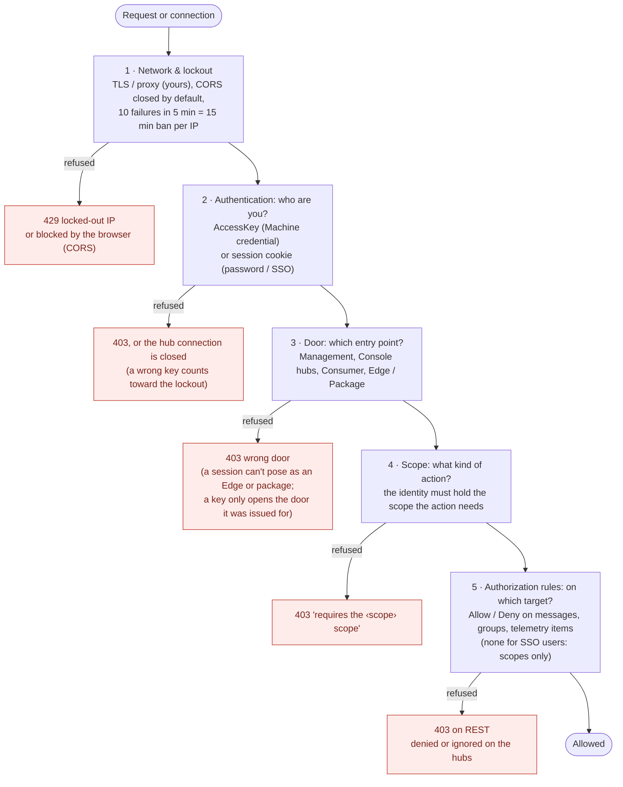

# Security

This document describes OrbitMesh's authentication and authorization model: what a credential is,
what scopes it can hold, and what's already in place versus what's a known limitation. The
[Access control guide](https://orbitmesh.org/guide/architecture/access-control) covers the same model with
diagrams, and the deployment checklist is at the end of this page.

## At a glance

Every request or connection passes five checks, in this order. Each can refuse it; the first refusal ends it.

Who can use which door:

| Door | Used by | Machine key | API token | Password session | SSO session |
| --- | --- | :---: | :---: | :---: | :---: |
| Management API (`/rest/management`) | Console, scripts | Yes, if the credential holds at least one scope; then the endpoint's own scope | Same | Yes | Yes |
| `ControlHub` | Console live view | Yes (same rule) | Same | Yes | Yes |
| `ConsumerHub`, `/rest/consumer` | Dashboards, Console | Yes, any enabled credential; then scopes and rules | Same | Yes | Yes |
| `EdgeHub` | An Edge | Only the credential assigned to that Edge, with `edge:connect` | **No** | No | No |
| `OrbitMeshHub`, `/rest/orbitmesh` | Packages | Only the credential assigned to that package (or its Edge), with `package:connect` | **No** | No | No |
| `Developer` edge | Local development | A key holding `developer` | REST only | No | No |

Open **on purpose**, each bounded: `/rest/enroll` (an Edge asking to be approved), `/rest/management/setup/*`
(first run only), `/rest/auth/*` (sign-in), static sites under a `FileServers` path, and `/metrics`
(Prometheus). Restrict `/metrics`, and anything a static site's own files expose (a config file holding a
key, say), with `localhostOnly`, your reverse proxy or a firewall.

## Credentials

A credential is either:

- **Human** — a console login (username + password). The server never stores the password itself,
  only a salted PBKDF2-SHA256 hash (600,000 iterations). It cannot be reversed or displayed again after
  creation. A Human credential is not something you present on each request: you sign in with it and get a
  session (see "Signing in" below).
- **Machine** — a bearer token for an Edge or a package (the PAT equivalent on most other platforms).
  The server stores it encrypted (AES-256-GCM) rather than hashed, because it has to hand the real value
  back out to an Edge/package that needs to authenticate with it. The encryption key lives in its own
  file (`keys/credential-encryption.key`, generated on first run, outside `appsettings.json`), so a leak
  of the config file alone doesn't hand over every Machine credential - both files have to be
  compromised together.

- **Token** — an **API token** for a script, a dashboard or a kiosk that calls the Console's APIs (never an
  Edge or a package). The Server generates it as `omk_<id>_<secret>` (a public 16-hex id and 256 bits of
  secret), shows it once, and keeps **only its SHA-256**: a random 256-bit secret has nothing to gain from a
  slow hash, and nothing ever has to read it back. The token is found by its id, so checking one costs a
  single hash, and it is compared in constant time. It can **expire**, be **rotated** (new id and secret, the
  old one stops at once) and be revoked on its own. It cannot hold `edge:connect`/`package:connect`, and the
  Server refuses it at an Edge's or a package's own door even if someone assigns it to one by hand-editing
  `appsettings.json`. The fixed `omk_` prefix lets secret scanners flag a leaked token: on GitHub, add
  `omk_[0-9a-f]{16}_[A-Za-z0-9_-]{43}` as a custom secret-scanning pattern.

A Machine key or an API token is shown **once**, at creation or reset/rotation, in the Console UI. It is never
displayed again afterwards - if it's lost, reset (or rotate) it and get a new one. (A Human password is the one
you typed, so there's nothing to show.) Prefer a token to a Machine key for anything that isn't an Edge or a
package.

## Signing in

People sign in to the Console with a username and password (`POST /rest/auth/login`) or through single
sign-on (below). Either way the result is a **session**: the browser gets one random opaque token in a
cookie that is `HttpOnly` (scripts can't read it), `SameSite=Strict` and `Secure` over HTTPS, and the
Server keeps only its SHA-256 (`keys/sessions.json`, so sessions survive a restart). Nothing derived
from the password is ever stored in the browser or sent again.

- A session ends on its own after 30 minutes without use (`Auth:SessionIdleMinutes`) and never lasts
  beyond 24 hours (`Auth:SessionMaxHours`). An open Console keeps itself alive.
- Signing out, disabling or removing the account, or resetting its password ends its sessions (a password
  reset spares the session that did it). A password session carries no rights of its own: what it may do
  is whatever the account holds right now, so changing its scopes applies at once.
- The cookie is ambient, so it is protected like one: a request carrying it is refused if its `Origin`
  isn't the Server itself, and any state-changing call must also carry the `EdgeName` header the Console
  sets (which another site's page can't, without a CORS preflight that is refused). The session only works
  for the Console's own connections (Management REST, `ControlHub`, `ConsumerHub`), never to pose as an
  Edge or a package.
- Wrong passwords count against the same per-IP lockout as wrong AccessKeys (a request with no
  credential at all - e.g. a Console whose session just expired - does not).
- Accounts created before sessions existed keep working: the first sign-in upgrades the stored hash to the
  current one, after which the old derived key stops being accepted. Scripts that used a Human account's
  derived key must switch to a Machine credential.
- `Auth:LocalLoginEnabled: false` turns the password form off (once single sign-on works, and keeping in
  mind that this also removes the account you'd use if the identity provider is down).

## Single sign-on (OpenID Connect)

OrbitMesh can delegate sign-in to an OpenID Connect provider - built and tested against
[Authelia](https://www.authelia.com/), but nothing is Authelia-specific. The Server is a *confidential
client* running the authorization-code flow with PKCE; the browser never holds a token, only the same
session cookie as above. Configure it under `OrbitMesh:Auth:Oidc` (see the "Access control" guide for the
full walk-through, including the Authelia side):

- **Who may sign in, and with what, is decided by the provider's groups**, through `RoleMappings`
  (`{ "group": "orbitmesh-admins", "scopes": ["*"] }`). A user gets the union of the scopes of every
  mapping whose group they belong to; a user with no matching group is refused. Mappings are read live,
  so editing one applies to open sessions.
- Such a user is named `oidc:<login>` in the audit log and has no credential entry; the `oidc:` prefix is
  reserved so a local credential can't pose as one. Authorizations (the per-target rules) default to
  Allow for them - scopes are the gate.
- Changing a role mapping obeys the same delegation rule as editing a credential (you can only map
  scopes you hold), and the raw-configuration editor refuses a change that would take your own
  `configuration:write` away.
- With single sign-on configured there is no first-run `create-admin`: the provider's groups decide who
  administers.
- Changing the provider settings needs a Server restart. A provider that is enabled but incomplete
  (no authority, client id or secret) is treated as off, with a message at startup.
- The Server must see the host name users reach it by (reverse proxy: keep the `Host` header, list the
  proxy in `TrustedProxies`), since the redirect URI sent to the provider is built from it.

## Scopes

A credential's permissions are a list of named scopes, not a single "admin or not" flag. This is the
same two-level model as AWS IAM: a scope authorizes an action *class*; the existing per-credential
Message/Group/TelemetryItem authorization rules (unchanged by this system) can still restrict *which*
specific targets that action applies to, once the scope already allows it.

| Scope | Grants |
|---|---|
| `edges:read` | View edges and their live connection state. |
| `edges:write` | Add, remove, or restart edges. |
| `packages:read` | View package instances, live status, logs and settings. |
| `packages:control` | Start, stop, restart or reload a running package. |
| `packages:manage` | Add, remove or reconfigure a package instance (settings, groups, recovery). |
| `packages:deploy` | Upload, install or remove packages in the Package Repository. |
| `telemetry:read` | View telemetry item values. |
| `telemetry:purge` | Delete stored telemetry item history. |
| `credentials:read` | View the list of credentials (never their keys). |
| `credentials:manage` | Create, edit, remove or reset credentials. The most sensitive scope, but delegation is limited: a holder can only grant scopes it holds itself, and can't edit or remove a credential carrying scopes it doesn't hold. |
| `configuration:read` | View the raw server configuration (secrets are masked). |
| `configuration:write` | Edit the raw server configuration or global recovery options. Subject to the same delegation rule for credentials; plaintext AccessKeys and reserved file-server paths are refused. |
| `updates:manage` | Check for and apply Server/Console/package updates. |
| `developer` | Direct developer workflows (messages, telemetry) without deploying a package to a real Edge. |

Scopes are checked at two levels:

1. **Connection-level** (`AccessKeyAuthenticationMiddleware` / `ControlHub.OnConnectedAsync`) - a
   coarse gate: does this credential hold *any* scope at all, for this connection family
   (Controller/live console, or Management/REST API)? This only rules out a credential with no
   business connecting to that family in the first place.
2. **Per-action** (`RequiresScopeAttribute` on every Management REST endpoint; an explicit
   `RequireScope(...)` call at the top of every mutating `ControlHub` method) - the specific scope that
   action actually needs. This is what makes a genuinely read-only credential possible: it can hold a
   live `ControlHub` connection and receive edge/package/telemetry updates, but every control or write
   RPC on that same connection still rejects it.

## First-run setup

A fresh install has zero credentials. `GET /rest/management/setup/status` and
`POST /rest/management/setup/create-admin` are the only unauthenticated endpoints - the Console uses
them to walk a first-run visitor through creating the sole admin account (all scopes) before anything
else works. `create-admin` re-checks "zero credentials" inside the same write lock it uses to persist
the new one, so two concurrent first-run requests can't both succeed.

**Known limitation:** there is no bootstrap secret (and, with single sign-on configured, none is needed). Until the first admin exists, whoever reaches the
port first creates it (with every scope, including `packages:deploy`, i.e. code execution on every
Edge). Create the account immediately after the first start, on a trusted network or with the port
firewalled. The last remaining credential can't be deleted, so the server can't be put back into this
state through the API.

## Edge enrollment

An Edge with no valid credential enrolls through the unauthenticated `rest/enroll` endpoints
(`POST` to register, `GET .../status` to poll). Because it is unauthenticated it is bounded and
validated: the InstanceId must be a GUID, text fields are length-capped, at most 100 entries (5 per
source IP) are held, a pending entry expires 15 minutes after its last poll, and each Edge sends a
persisted secret (only its SHA-256 is stored) with every call - so knowing an InstanceId, which any
`edges:read` user can see, is not enough to collect the approved key or hijack another Edge's entry.
The approved key is held in memory only until the Edge reconnects with it (or 10 minutes). The
pending list shows only self-declared data: approve an Edge you recognise.

## What's already in place

- **Salted PBKDF2 password hashing** (Human), **AES-256-GCM encryption** (Machine) and **server-side
  sessions** - see above. A verified AccessKey is remembered (by hash, in memory) until the configuration
  reloads, so authorization checks don't re-run the key derivation on every request.
- **Rate limiting** (`LoginAttemptLimiter`) - 10 failed attempts from the same IP within 5 minutes
  triggers a 15-minute lockout for that IP, independent of which credential was being tried. It covers
  REST and all four SignalR hubs, and a successful request does not reset the count (so an attacker
  holding one valid key can't interleave successes to avoid the lockout). Behind a reverse proxy, list
  it in `OrbitMesh:TrustedProxies` so the real client address is used.
- **Constant-time key comparison** for Machine credentials.
- **Secrets masked on read** - `configuration:read` and `packages:read` never return credential
  keys/hashes, the update token, NuGet feed API keys, secret variables or Password-typed package
  settings; the Console's editors round-trip a placeholder that keeps the stored value.
- **Signed, version-bound updates** - a release must carry a manifest signed by a key in
  `UpdateOptions:PublicKeys`, whose file hashes match, and whose signed version is the announced one and
  newer than the running one (no downgrade/replay). With no key configured, updates are refused unless
  `UpdateOptions:AllowUnsignedReleases` is set. The update token is only sent to the update server's
  own host.
- **Response hardening** - `X-Content-Type-Options`, `X-Frame-Options`/`frame-ancestors`,
  `Referrer-Policy: no-referrer` (AccessKeys can appear in query strings), `Cache-Control: no-store` on
  `/rest`, and HSTS over HTTPS. The session cookie is `HttpOnly`, `SameSite=Strict` (and `Secure` over HTTPS).
- **Audit logging** - every mutating (`POST`/`PUT`/`DELETE`/`PATCH`) call to `/rest/management` is
  logged with the caller's resolved credential name, to a separate long-retention log category (`Audit`
  in `NLog.config`).
- **Self-lockout guard** - `POST /rest/management/configuration` (the raw-JSON config editor) refuses to
  save a change that would revoke the calling credential's own `configuration:write` scope.
- **Console login is username/password or single sign-on only** - Machine (bearer-token) credentials
  cannot be used to log into the Console UI, only to authenticate an Edge or package.

## Known limitations

- **No scope self-lockout guard outside the raw config editor.** Editing a credential's own scopes
  through the normal Credentials page (`POST /rest/management/credentials`) does not check whether the
  change would revoke the caller's own access, unlike the raw-JSON config editor above. Be careful
  removing `credentials:manage` from the account you're currently using.
- **Plain HTTP by default.** The Server listens on `http://+:8088` out of the box. Use a TLS reverse
  proxy or Kestrel's own certificate (see the "Securing the Server" section of the docs); the Edge only
  warns about a plain-HTTP server URL unless `Edge:RequireHttps` is set.
- **Hub connections outlive their session.** A `ControlHub`/`ConsumerHub` connection opened with a session
  cookie keeps working until it closes, but every hub call re-checks the session, so once it expired or was
  revoked each call fails. A changed *Machine* key behaves the same way for connections already open.
- **Single sign-on has no back-channel logout.** Signing out of the identity provider doesn't end the
  OrbitMesh session; it ends by idle timeout, absolute lifetime, or signing out of the Console.
- **Authorizations default to Allow** for Edge and Human credentials created through the Console or by
  approving an Edge (package credentials auto-provisioned by the Server default to Deny). Scopes are the
  real gate; tighten the rule sets per credential where it matters.
- **No expiry on Machine credentials.** A generated key is valid until manually reset or the credential
  is disabled/removed. For time-limited access use an API token with an expiry.
- **A rotated or revoked token stops working when the configuration reloads** - a fraction of a second after
  the change, not instantly. A hub connection it already opened stays open, but its credential is looked up again on each
  call, so the calls are refused.
- **Authorizations are still a single flat list of rules** (Messages/Groups/TelemetryItems), not scoped
  per-credential-kind or bulk-editable; this predates the scope system and hasn't changed.

## Deployment checklist

- Serve over **HTTPS** (a TLS reverse proxy, or Kestrel itself). Without it AccessKeys and passwords cross
  the network in clear and the session cookie can't be marked `Secure`.
- Behind a reverse proxy, list it in **`OrbitMesh:TrustedProxies`** and keep the original `Host` header: the
  lockout, `localhostOnly` and the single sign-on redirect address all depend on them.
- Create the **first admin right away**, or configure single sign-on (which removes that step).
- **Back up `appsettings.json` and the `keys/` folder together.** Without `keys/credential-encryption.key`
  Machine keys can't be read back. `keys/` also holds the sessions (`sessions.json`, hashes only) and the
  Data Protection ring used by single sign-on - keep its permissions tight.
- Use **API tokens, with an expiry,** for scripts, dashboards and kiosks; keep Machine keys for Edges and packages.
- Give each Machine credential or token **only the scopes it needs** and tighten its `authorizations`: a dashboard
  that only displays telemetry needs `telemetry:read`, nothing else.
- **Restrict `/metrics`**, and keep secrets out of files served by a `FileServers` path - those are public
  unless `localhostOnly` or your proxy says otherwise.
- Set **`UpdateOptions:PublicKeys`** so self-updates are verified.
- Before disabling local sign-in (`Auth:LocalLoginEnabled: false`), check that single sign-on works and that
  you have another way in should the identity provider be down.
